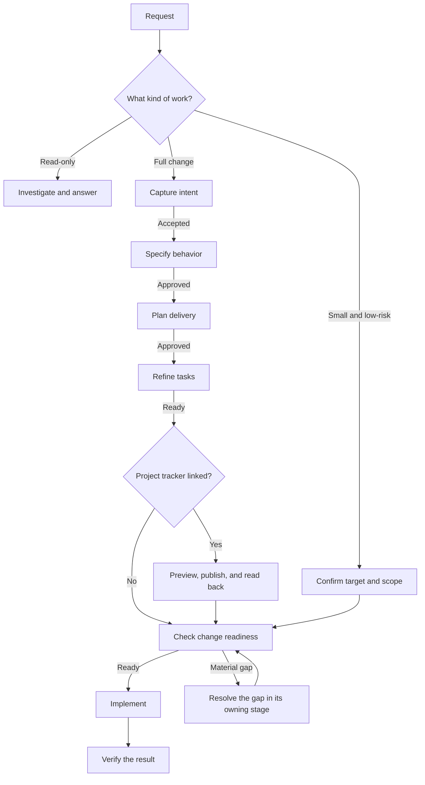

# Subspace

<!-- toc -->
## Contents

- [Choose the route](#choose-the-route)
  - [Interpret indirect requests](#interpret-indirect-requests)
- [Fast path for small changes](#fast-path-for-small-changes)
- [Full workflow](#full-workflow)
- [Defaults](#defaults)
- [Supporting routes](#supporting-routes)
- [Evaluate Subspace](#evaluate-subspace)
<!-- tocstop -->

Select the workflow that fits the request before implementation. Reassess when
the user introduces new work or changes scope. Reuse the current route and
recorded decisions when they still apply. Loading Subspace does not mean every
request needs change artifacts.

For a delegated task, follow the supplied scope and approvals. Report new
requirements to the owner instead of restarting the full workflow yourself.
Follow explicit user and repository instructions when they override these
defaults. Load relevant skills based on the actual task. A delegated worker
doesn't share the parent's context: load the principles its own task needs.

## Choose the route

1. Classify the request as a read-only question, a small change, full delivery
   work, or a continuation of approved work. Inspect enough context to confirm
   the scope; don't infer impact from wording or file count alone.
2. For a read-only question, use `investigation`, `how`, or `why`. For a bug,
   use `root-cause-debugging` before choosing a fix, then classify that fix.
3. For a small change, follow the fast path below. For a larger feature or a
   change with unresolved product scope, start with intent capture.
4. For existing work, read the relevant artifacts and resume at the first
   incomplete stage. A changed requirement returns to specification; a changed
   purpose or product scope returns to intent. Don't recreate approved work.
5. Before implementation, use **check-change-readiness**. It checks the chosen
   route and available evidence; it doesn't create another approval stage.

Interpret the requested outcome, not a phrase in isolation. These examples
are recognition aids, not a keyword trigger list:

| Request | How to interpret it |
| --- | --- |
| "What I'd like you to do next is add project export." | New feature; capture intent if scope is not approved. |
| "I want to let customers export their records." | Desired capability; clarify intent and required behavior. |
| "Could you change this button from green to blue?" | Likely fast path; confirm target, scope, and accessibility. |
| "Let's add passwordless sign-in." | New security-sensitive feature; use the full workflow. |
| "Next up, please fix the typo in this label." | Likely fast path; an ongoing conversation does not make it a large change. |
| "Make it blue instead." | Resolve "it" from context; ask only if the target or color is unclear. |
| "We should support multiple organizations per account." | New product scope; capture intent. |
| "Can you explain why this button is green?" | Read-only explanation, not an instruction to change the color. |
| "What should we do next?" | Recommend a next step; don't start implementation without a request. |
| "Continue with task 02." | Resume approved work after checking readiness and dependencies. |
| "Do we need a Mermaid diagram here?" while editing one document with an agreed flow | A request to add the diagram; use the fast path if only that document changes. |
| "Do you think it might be better to use delivery.md instead of plan.md?" while revising the workflow | A proposed change to the active design, not just a request for an opinion; revise the relevant scope or artifact. |
| "Could we perhaps make this button blue rather than green?" | A polite request for the color change; likely fast path. |
| "I wonder if we could support multiple organizations per account." | A tentative feature request; capture the desired outcome. |
| "Do you think blue or green is more accessible? Compare them before changing anything." | Advice only; compare options without editing. |

### Interpret indirect requests

Polite or tentative wording, including common British English phrasing, can
request action. Use the conversation and concrete outcome to decide. When a
suggestion names a change to the work in progress, treat it as a request to
assess and carry out that change through the appropriate route. Don't stop at
"yes, that might be better" or ask the user to repeat the suggestion as an
imperative. Briefly state the intended action and proceed when it is clear
and within the existing authorization.

"Do we need," "might it be better," and "could we perhaps do X rather than Y"
are not always action requests. A comparison question, an explanation request,
an explicit instruction to wait, or an unresolved choice can require an answer
first. Ask one focused question only when the context leaves materially
different interpretations. Politeness does not authorize destructive actions,
publication, or bypassing full-workflow approvals.

The fast path goes from scope confirmation to readiness, implementation, and
verification. The full path first prepares the artifacts and, when applicable,
publishes the reviewed work to the project's tracker.

## Fast path for small changes

Use this path when the outcome and target are clear, the change is local,
low-risk, reversible, and follows an existing pattern. It must have a direct
verification method. For example, "Change button from green to blue" normally
qualifies once the button and intended blue are clear from context.

1. Inspect the affected element and its consumers. Confirm the change doesn't
   unintentionally alter a shared theme or another feature.
2. Run **check-change-readiness** using the request and source context. Ask
   only about an unresolved decision that can change the result.
3. Make the bounded edit with the relevant engineering skill and run the
   smallest direct check. For a visual change, check the rendered result and
   applicable contrast or state indicators.
4. Report the change and verification. The explicit request authorizes this
   bounded edit; don't ask for another approval just to satisfy the process.

Don't require intent, spec, delivery, or task files, a tracker item, an
interview, or delegation for this path. A small diff that changes access
control, public contracts, data integrity, or external resources does not
qualify merely because it is short. If inspection reveals wider impact,
reclassify the work and explain why. An unclear color choice alone needs a
focused question, not a full change package.

## Full workflow

Use **Intent → Specification → Delivery → Tasks** for larger features and
changes that require product or design decisions. Follow the templates in
[`change-artifacts.md`](./references/change-artifacts.md).

| Stage | Question | Artifact | Playbook |
| --- | --- | --- | --- |
| Intent | Why are we doing this? | `intent.md` | [`Capture intent`](./playbooks/capture-intent.md) |
| Specification | What behavior should exist? | `spec.md` | [`Design the specification`](./playbooks/design-spec.md) |
| Delivery | What approach and scope will satisfy the spec as a shippable unit? | `delivery.md` | [`Plan delivery`](./playbooks/refine-delivery.md) |
| Tasks | What bounded work needs doing? | `task-NN-<desc>.md` | [`Refine tasks`](./playbooks/refine-delivery.md) |

Use research, brainstorming, and user questions as needed during intent
capture. Write precise behavioral or functional requirements before choosing
the implementation approach. Planning produces `delivery.md`, also called a
product backlog item (PBI) or delivery plan. Don't create a separate `plan.md`
for new changes. Reuse existing plans without duplicating their decisions.

Obtain intent acceptance, spec approval, delivery approval, and task readiness
for this full workflow. Record the actual decisions in frontmatter. Then use
**check-change-readiness** before implementation. Don't repeat a completed
approval or infer approval from silence, file existence, or a successful command.

Each stage also considers the `principle-*` skills that apply to it, using
[`principle-routing.md`](./references/principle-routing.md). The reference maps
every principle to its stages and observable triggers. Load a matching
principle explicitly before the decision it affects; don't load all of them.
Principles inform a stage's own decisions, add no stage, artifact, or approval,
and never override a recorded approval. The fast path and read-only work skip
the full matrix.

If the project has a linked tracker, follow
[`Publish work items`](./playbooks/publish-work-items.md): preview, publish,
read back, and reconcile. Delivery becomes the parent item; task files become
children. Record their IDs and URLs in source frontmatter. Use the project's
actual hierarchy, such as an Azure DevOps PBI with child Tasks. Without a linked
tracker, keep the same artifacts locally. An inaccessible linked tracker is
a publication blocker unless the owner explicitly defers publication.

## Defaults

- Store full-workflow artifacts in `docs/changes/<slug>/`, or the configured
  `changes_home`. Use frontmatter for status, approvals, and tracker references.
- Use the project's linked tracker rather than assuming a particular provider.
- Delegate implementation only when useful and the harness provides a subagent
  or coding agent; otherwise do the work directly. Use the agent the user or
  repository names when one is named.
- Use worktrees for independent writers and the repository host's pull or merge
  requests for requested review. Commit, publish, push, or open a pull request
  only when authorized.
- Use the host's available tools. Don't assume a specific editor or provider.

## Supporting routes

When work concerns domain language, model boundaries, integration meaning, or
core-domain priorities, use **domain-modeling** within the current stage or
read-only investigation. Use available evidence, label assumptions, and ask
only questions that can change the decision. Access to domain experts is not
a prerequisite; this route adds no stage or approval and preserves the fast path.

Keep agreed domain terms in the project's Markdown glossary and link that entry
from change artifacts. Follow the
[glossary location reference](../domain-modeling/references/glossary.md) to find
or choose the file; ask the user when the location is unclear.

| Work | Route |
| --- | --- |
| Argo CD Applications, AppProjects, ApplicationSets, GitOps promotion or sync/recovery diagnosis | Explicitly load `argocd-gitops` |
| Register or diagnose an AKS target's Argo CD identity, API connectivity or authorization | Explicitly load `argocd-aks-registration` |
| Author Kubernetes workloads or Kustomize roots, generators, replacements, bases and overlays | Explicitly load `kubernetes-kustomize` |
| Choose a skill or explain a workflow | [`ask-subspace`](../ask-subspace/SKILL.md) |
| Clarify goals or decisions | [`brainstorm`](../brainstorm/SKILL.md) or [`interrogate`](../interrogate/SKILL.md) |
| Check before implementation | [`check-change-readiness`](../check-change-readiness/SKILL.md) |
| Design a non-trivial implementation | [`architect`](../architect/SKILL.md), design only during planning |
| Clarify domain language, model boundaries, integration, or core priorities | [`domain-modeling`](../domain-modeling/SKILL.md), within the current stage or read-only investigation |
| Draw architecture, flow, or ownership as text | [`create-ascii-diagram`](../create-ascii-diagram/SKILL.md) |
| Implement full-workflow tasks | [`Feature`](./playbooks/feature.md), [`Bug fix`](./playbooks/bug-fix.md), or [`Refactoring`](./playbooks/refactoring.md) |
| Plan multiple phases or pull requests | [`Multi-phase plan`](./playbooks/multi-phase-plan.md), within `delivery.md` |
| Investigate performance or runtime behavior | [`Performance issue`](./playbooks/perf-issue.md) or [`Runtime forensics`](./playbooks/runtime-forensics.md) |
| Explain existing behavior | [`Investigation`](./playbooks/investigation.md), [`how`](../how/SKILL.md), or [`why`](../why/SKILL.md) |
| Resume or pause work | [`Session pickup`](./playbooks/session-pickup.md) or [`Pause safely`](./playbooks/pause-safely.md) |
| Coordinate long-running work | [`Orchestrate`](./playbooks/orchestrate.md) |
| Create authorized commits or draft commit messages | [`create-commits`](../create-commits/SKILL.md) |
| Draft, create, or update pull request text | [`writing-pull-requests`](../writing-pull-requests/SKILL.md) |
| Prepare an authorized pull request | [`Opening a PR`](./playbooks/opening-a-pr.md) |

The DevOps routes are optional installed specialists, not dependencies of the
workflow package. After choosing the playbook, explicitly load the named skill
with the host's skill tool, or read its known installed `SKILL.md` where no
loader tool exists. Do not rely on automatic matching. For Codex, an explicit
`$skill-name` invocation remains available when implicit invocation is disabled.
Being hidden from the advertised list is not evidence that a skill is absent.
Check the registered skill or known installation before reporting a gap. If
no explicit loading method or known path is available, ask the user to invoke
the skill explicitly, for example `$skill-name` in Codex or `@skill-id` in
OpenCode. Do not bypass a permission
denial. For an absent optional set, do not install it without authority or
block unrelated workflow routing. Keep AKS provisioning,
Flux-only work and standalone Helm templating outside these DevOps routes.

Use **verification-before-completion** before claiming a result.

## Evaluate Subspace

When asked to run Subspace evals or when changing its routing, follow
[`Evaluate routing`](./references/evaluating-subspace.md). Use fresh, available
lower-capability or low-reasoning subagents. Test the phrases above and the
[`Workflow scenarios`](./references/workflow-scenarios.md). Give tested agents
only inputs and allowed context, not expected answers. Score their actual
responses and record failures. Running evals is a verification task, not a new
delivery workflow.
