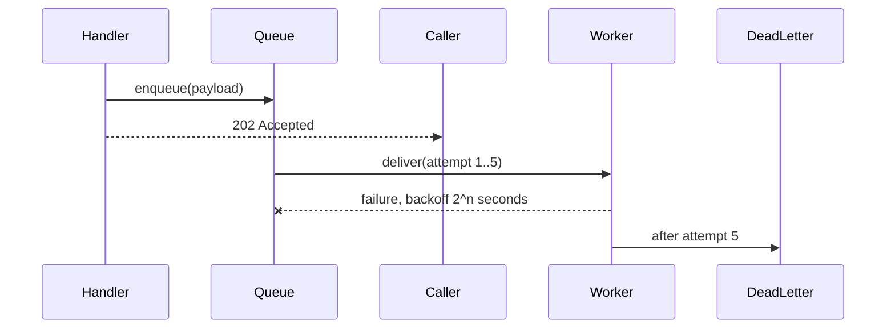

# PR Body Examples

<!-- toc -->
## Contents

- [Small Change](#small-change)
- [Multi-topic change with a dependency](#multi-topic-change-with-a-dependency)
- [Skills package without session notes](#skills-package-without-session-notes)
- [Flow Better Shown as a Diagram](#flow-better-shown-as-a-diagram)
- [Breaking Contract](#breaking-contract)
- [Evidence of a Fix](#evidence-of-a-fix)
- [Irreversible Change](#irreversible-change)
<!-- tocstop -->

## Small Change

```markdown
The AI Customizations section now starts collapsed so it does not consume sidebar space before users need it. Expanding it preserves the existing saved preference behavior.
```

## Multi-topic change with a dependency

Use headings to separate reviewer questions, not to fill a fixed template.
This illustrative draft shows the structure; use verified references and
results for the actual PR.

Title: `feat(ingress): enable wildcard hostnames in staging`

```markdown
Staging applications can add hostnames through `HTTPRoute` manifests without separate DNS records and edge domains for each application.

### Module dependency

`modules_ref` uses the shared module's wildcard-only revision. Its wildcard code matches the merged change, but it excludes an unrelated monitoring migration in `main`. Workflow defaults use the same immutable pin.

### Scope

- Enable wildcard ingress in staging; test and production keep fixed domains.
- Retain existing named domains, the private origin and proxy routing behaviour.
- Use the existing protected network and route stages. Cluster and proxy plans must be no-op for this rollout.
- Wildcard certificate renewal needs an agreed owner before production use.

### Verification

`make wildcard-validate` passed for all three environments, including omitted defaults and populated, null and absent optional domain IDs. Existing admin and workflow checks also passed.
```

## Skills package without session notes

```markdown
Adds the independent `platform-skills` package with GitOps, cluster registration and Kubernetes manifest authoring skills. The guidance starts with one Kustomize root and uses overlays only for real variants.

The installer refuses divergent content and symlinks and preserves helper execute bits. Rendering and installation regression tests passed.
```

Do not append the author's installation path, agent authorization, a generic
"publication remains separate" statement, or a routine revert/no-change footer.
Keep an actual missing release dependency or untested rollout step when the
change evidence establishes it.

## Flow Better Shown as a Diagram

````markdown
Failed webhook deliveries now retry through a delay queue instead of a blocking loop in the request handler. The handler returns after it enqueues the payload, so a slow consumer no longer holds a worker.


````

## Breaking Contract

````markdown
Run logs now emit chunk-level records instead of one skill-level record. Consumers that read top-level `findings` must iterate over `chunk.findings` in each record.

Before:

```json
{"skill": "security-review", "findings": [...]}
```

After:

```json
{"schemaVersion": 1, "chunk": {"index": 1, "findings": [...]}}
```
````

## Evidence of a Fix

````markdown
Session restore no longer drops the last message when a client reconnects during a write. `SessionStore.append` now writes the message before it publishes the offset, so a reader cannot observe an offset without its message.

The reproduction in `tests/session_restore_test.go:112` failed on `main` and passes here:

```text
--- FAIL: TestRestoreDuringWrite (0.41s)  # main
    want 20 messages, got 19
--- PASS: TestRestoreDuringWrite (0.44s)  # this branch
```

````

## Irreversible Change

````markdown
Archived runs older than 90 days are deleted during the nightly `retention` job instead of being marked `hidden`. Storage for the `runs` bucket drops from 4.1 TB to about 0.6 TB after the first full pass.

Deletion is not reversible: the job removes the objects and their rows, and the bucket has no versioning. Backups cover 30 days, so a wrong retention window is recoverable only within that period.

Review `RetentionPolicy.cutoff` first. The first scheduled run after merge deletes production data, so merge only when the 90-day window is agreed.
````
